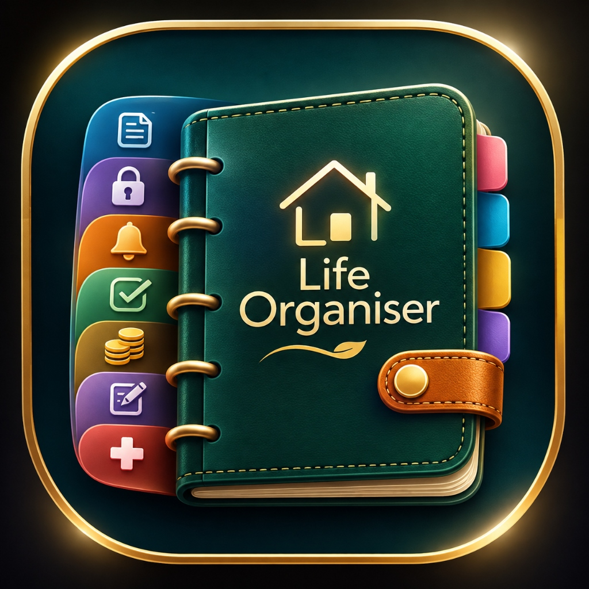

<p align="center">
  
</p>

<h1 align="center">Life Organiser</h1>

<p align="center">
  <b>Your Ultimate Personal Productivity, Finance & Privacy Companion for Android</b>
</p>

<p align="center">
  <a href="https://github.com/shintopc/LifeOrganiser/releases/tag/v1.0.1">
    
  </a>
  
  
  
</p>

---

## 📱 Overview

**Life Organiser** is a robust, privacy-first, all-in-one productivity suite built natively with **Kotlin** and **Jetpack Compose**. It unifies task management, smart reminders, full personal finance tracking, encrypted credential vaults, and emergency medical records into a cohesive **"Quiet Luxury" Bento UI**.

Designed with **100% offline-first architecture**, your sensitive data never leaves your device and stays protected behind biometric and PIN encryption.

---

## 🚀 Quick Download

Get the official, signed production APK:

[](https://github.com/shintopc/LifeOrganiser/releases/download/v1.0.1/LifeOrganiser-v1.0.1-release.apk)

> Or visit the [GitHub Releases Page](https://github.com/shintopc/LifeOrganiser/releases/tag/v1.0.1) for verify checksums and assets.

---

## ✨ Key Features

### 🎨 1. "Quiet Luxury" Aesthetic & Navigation
* **Bento Grid Architecture:** Clean, modular cards with 20dp/24dp radii and fine hairline borders.
* **Floating Island Dock:** Sleek bottom navigation with smooth animated selection pills and spring-physics touch response.
* **True Obsidian Dark Mode:** Deep `#090A0F` canvas tuned for OLED displays alongside a crisp slate-neutral light theme.
* **Editorial Typography:** Material 3 type hierarchy with custom optical tracking for headers and micro-badges.

---

### 🛡️ 2. Hardware-Backed Security Vault
* **Master PIN & Biometrics:** Fingerprint and Face Unlock support with a tactile, animated fintech-style keypad.
* **Screenshot & App-Switcher Protection:** Built-in `FLAG_SECURE` prevents unauthorized screen recordings, screenshots, and recent-app previews.
* **Local Encryption:** Hardware-backed cryptographic keys for all sensitive vaults.

---

### 💰 3. Comprehensive Financial Hub
* **Daily Financial Snapshot:** Real-time net balance calculations, income/expense breakdown, and deficit warnings.
* **Budget Tracking:** Multi-state visual progress bars (Healthy / Approaching Limit / Over Budget).
* **Loan & EMI Manager:** Track bank loans, upcoming monthly EMIs, and due dates.
* **Borrow & Lend Ledger:** Keep clear records of money borrowed from or lent to contacts with one-tap debt closure.

---

### ✅ 4. Tasks & Calendar Planning
* **Priority Management:** High, Medium, and Low priority tiers with color-coded tags.
* **Subtasks & Checklists:** Break down complex goals into actionable checklist steps.
* **Integrated Timeline:** Unified view linking today's scheduled tasks, reminders, and due payments.

---

### ⏰ 5. Smart Time-Sensitive Reminders
* **Exact Alarms:** Powered by Android AlarmManager and BootReceiver to guarantee alerts even after a device restart.
* **Custom Notification Channels:** High-priority heads-up alerts for urgent events.

---

### 🔐 6. Digital Vaults & Emergency Info
* **Password Vault:** Securely store accounts, usernames, and encrypted passwords.
* **Document Organizer:** Digitize physical papers and view stored documents directly in-app.
* **Emergency Medical & Contacts:** Immediate one-tap access to primary contacts and vital health info when every second counts.
* **Modular Customization:** Rearrange or toggle any module to match your personal daily workflow.

---

## 🛠️ Architecture & Tech Stack

| Layer | Technology |
| :--- | :--- |
| **Language** | Kotlin 1.9 (Java 11 target) |
| **UI Framework** | Jetpack Compose with Material 3 |
| **Architecture** | MVVM + Clean Architecture + Kotlin StateFlow / Coroutines |
| **Dependency Injection** | Dagger Hilt 2.48 |
| **Local Database** | Room Database 2.6.1 |
| **Security** | AndroidX Biometric 1.1.0 & AndroidX Security Crypto 1.0.0 |
| **Image Loading** | Coil 2.7.0 |

---

## 🏗️ Building from Source

### Prerequisites
* Android Studio Iguana / Ladybug or newer
* JDK 17 or JDK 21
* Android SDK (API Level 34)

### Steps

1. **Clone the repository:**
   ```bash
   git clone https://github.com/shintopc/LifeOrganiser.git
   cd LifeOrganiser
   ```

2. **Build Debug APK:**
   ```bash
   ./gradlew assembleDebug
   ```

3. **Build Signed Release APK:**
   Configure your signing properties in `keystore.properties` (or use local properties) and run:
   ```bash
   ./gradlew assembleRelease
   ```
   The signed APK will be output at `app/build/outputs/apk/release/app-release.apk`.

---

## 📄 License & Credits

Designed and maintained by **ShintoPC Labs**.  
Copyright © 2026 [Shinto PC](https://github.com/shintopc). All rights reserved.


